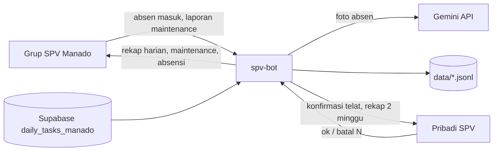

# SPV Bot KC Manado: rekap otomatis di WhatsApp

## 1. Tujuan

Bot WhatsApp khusus tim SPV KC Manado yang mengirim empat rekap otomatis:

| Rekap | Tujuan | Jadwal (WITA) | Sumber data |
|---|---|---|---|
| Pekerjaan selesai dan belum selesai hari itu | Grup | Tiap hari 23:00 | Supabase `daily_tasks_manado` |
| Temuan maintenance "harus diganti" dan "sudah mulai rusak" | Grup | Tiap hari 23:00, hanya bila ada temuan | Laporan maintenance di grup |
| Absensi masuk periode 26 s/d 25 | Grup | Tanggal 26, 09:00, setelah SPV konfirmasi | Pesan dan foto absen masuk di grup |
| Pekerjaan selesai 2 minggu | Pribadi SPV | Tiap Jumat 09:00 | Supabase `daily_tasks_manado` |

Sebelum rekap absensi, bot mengirim daftar telat ke SPV (tanggal 25, 20:00) untuk dikonfirmasi.

Di luar cakupan: command manual `!rekap`, cabang Bali dan HO, perubahan pada aplikasi Flutter.

## 2. Arsitektur



- Repo baru `spv-manado-bot/`, sejajar dengan `BssparkingTimeMark/`. Node.js, `whatsapp-web.js`, `@google/genai`, `node-cron` dengan timezone `Asia/Makassar`.
- Nomor WhatsApp baru, sesi `LocalAuth({ clientId: 'spv-manado' })`, terpisah dari bot Roki.
- Deploy di LXC CT 100, folder `/root/spv-bot`, proses PM2 `spv-bot`. Chromium yang dipakai Roki dipakai ulang.
- Satu grup dipakai untuk membaca laporan sekaligus mengirim rekap. Bot wajib menjadi anggota grup.

Modul:

| File | Tugas | Bergantung pada |
|---|---|---|
| `src/parse.js` | Mengenali pesan absen masuk dan laporan maintenance dari teks | daftar teknisi, daftar shift |
| `src/vision.js` | Membaca tanggal dan jam dari watermark foto absen | Gemini API |
| `src/store.js` | Menyimpan hasil parsing ke JSONL, dedupe per message id | filesystem |
| `src/tasks.js` | Mengambil tugas dari Supabase | REST Supabase |
| `src/format.js` | Menyusun teks keempat rekap dan pesan konfirmasi | tidak ada (fungsi murni) |
| `src/schedule.js` | Jadwal cron, catch-up setelah restart, status kirim | store |
| `src/confirm.js` | Alur konfirmasi telat dari SPV | store |
| `src/index.js` | Klien WhatsApp, event pesan, backfill | semua modul |

`format.js` dan `parse.js` tidak menyentuh jaringan, sehingga dapat diuji dengan data contoh.

## 3. Konfigurasi `.env`

```
GROUP_NAME=            # nama grup persis, dicocokkan saat bot siap
SPV_NUMBER=62895803663572
SUPABASE_URL=
SUPABASE_ANON_KEY=
GEMINI_API_KEY=
GEMINI_MODEL=gemini-3.1-flash-lite
TEKNISI=Ryan Lumasuge:Ryan,Raldy Sangkop:Raldy,Junifer Manua:Junifer,Alessandro Sulistyo:Ale
DRY_RUN=0              # 1 = semua pesan dikirim ke SPV_NUMBER, bukan ke grup
```

`TEKNISI` berisi nama lengkap dan nama panggilan. Nama panggilan dipakai di rekap 2 minggu dan untuk pencocokan nama. `.env` tidak masuk git. Kunci API tidak pernah dicetak ke log.

Daftar shift KC Manado ditanam di kode, sama dengan `BranchService.getShifts()`: Shift 1 03:00, Shift 1.1 06:00, Shift 2.2 10:00, Shift 2 10:00, Shift 3 14:00.

## 4. Membaca pesan grup

Bot membaca `msg.body` untuk pesan teks maupun caption media. Pengirim diambil dari `msg.author`, waktu dari `msg.timestamp`. Teks bisa datang sebagai caption foto, bisa juga ditempel terpisah, karena app selalu menyalin teks laporan ke clipboard (`camera_capture_screen.dart:1643`, `share_helper.dart:345`).

### 4.1 Absen masuk

Pesan dihitung sebagai absen masuk bila memuat ketiganya:

- frasa `Laporan Jadwal Masuk`
- baris `IT Support : <nama>`
- baris `Jadwal Shift : <shift>`

Aturan pencocokan:

- Spasi di sekitar titik dua boleh tidak ada. Huruf besar kecil diabaikan.
- Nama dicocokkan ke `TEKNISI`, baik dengan nama lengkap, kata pertama, maupun nama panggilan. Nama yang tidak cocok dicatat sebagai "gak kebaca".
- Shift dicocokkan ke daftar shift Manado lewat label (`Shift 1.1`) atau jam di dalam kurung (`06:00` atau `06.00`).
- Baris tambahan seperti `Catatan GPS:` diabaikan.
- Satu teknisi, satu tanggal, satu shift hanya dihitung sekali. Yang dipakai pesan paling awal.

### 4.2 Jam masuk dari foto

Watermark foto memuat jam terverifikasi dalam format `HH:MM` (`image_watermark_processor.dart:398`). Untuk tiap absen masuk:

1. Cari fotonya. Kalau pesan absen adalah caption foto, foto itu yang dipakai. Kalau teks dikirim terpisah, bot mencari foto dari pengirim yang sama dalam rentang 10 menit sebelum atau sesudahnya.
2. Foto diambil lewat `msg.downloadMedia()` lalu dikirim ke Gemini dengan `inlineData` dan `responseMimeType: application/json`. Yang dibaca hanya jam: prompt `Baca jam di watermark foto absensi. Balas JSON {"jam":"HH:MM"}. Kalau tidak terbaca, isi null.` Label lokasi dan tanggal di watermark tidak dibaca.
3. Hasil AI hanya dipakai bila jamnya berformat `HH:MM`, tidak lebih lambat daripada jam pesan dikirim, dan selisihnya dengan jam kirim paling lama 3 jam.
4. Bila foto tidak ditemukan, API gagal, atau hasil tidak lolos pemeriksaan, jam masuk diambil dari `msg.timestamp` dan entri ditandai `jam dari WA`.

Hasil AI disimpan bersama entri absen, sehingga satu foto hanya dibaca sekali.

### 4.3 Laporan maintenance

Pesan dihitung sebagai laporan maintenance bila memuat `Lokasi :` dan `IT Support :`, serta minimal satu baris temuan dengan tag `(harus diganti)` atau `(sudah mulai rusak)`. Tanda bintang di sekitar tag diabaikan.

Dari tiap baris temuan diambil:

- Unit, bila barisnya berbentuk `⚠️ <unit>: <alasan>`. Laporan satu unit hanya memuat `⚠️ <alasan>`, sehingga unitnya dikosongkan.
- Alasan, yaitu teks setelah unit dan sebelum tag.
- Tingkat urgensi dari tag.

Lokasi diambil dari baris `Lokasi :`, IT Support dari baris `IT Support :`, sedangkan jam dari `msg.timestamp`. Bot tidak mengambil nama barang, karena nama itu tidak ada di teks laporan.

### 4.4 Validasi terhadap chat asli

User bukan admin grup, jadi export chat tidak tersedia. Fixture awal untuk `parse.js` disusun dari format teks di kode app (`camera_capture_screen.dart:1445` untuk absen masuk, `whatsapp_report_service.dart` untuk maintenance), ditambah variasi yang wajar: spasi titik dua hilang, huruf besar kecil berbeda, baris `Catatan GPS:` tambahan, nama panggilan. Validasi terhadap pesan asli dilakukan pada minggu pertama dengan `DRY_RUN=1`: bot membaca grup sungguhan, lalu `data/unparsed.jsonl` dicek dan aturan ditambah bila ada pesan yang lolos.

Pembacaan jam sudah diuji pada 3 foto asli di `assets/foto absensi/` dengan `gemini-3.1-flash-lite`, dan hasilnya 3 dari 3 benar (13:55, 02:26, 09:39). Label di samping jam berbeda-beda (`MGLG`, `Absensi`, `ABSENSI`), dan karena itu label tersebut tidak dipakai.

### 4.5 Pesan yang gagal dibaca

Pesan yang memuat `Laporan Jadwal Masuk` atau tag urgensi tetapi gagal diparsing disimpan di `data/unparsed.jsonl`. Pesan seperti ini dicantumkan di bagian bawah pesan konfirmasi telat ke SPV, supaya bisa dicek manual.

### 4.6 Backfill

Pesan yang masuk ketika bot mati diambil ulang saat bot siap lewat `chat.fetchMessages({ limit: 500 })`. Dedupe per message id mencegah entri ganda. Penyimpanan JSONL dipakai supaya rekap bulanan tidak bergantung pada riwayat yang dimuat WhatsApp Web.

## 5. Format pesan

Lokasi selalu ditulis di belakang dengan pemisah ` - `, tanpa kurung. Pesan tidak memakai footer.

### 5.1 Rekap pekerjaan harian, grup, 23:00

Tugas diambil dengan `tanggal = hari ini`. Progres hanya menghitung tugas bertanggal hari itu, sama dengan `formatSpvTeamRecap`. Pelaksana adalah `teknisi_nama` ditambah `peserta`.

```text
*REKAP DAILY TEAM PMA KC BSG*
SPV : FARHAN LAKORO
Tanggal : Kamis, 29 Oktober 2026
Progress : 9/12 (75%)

*Status per Teknisi*
Ryan Lumasuge : 3/3 selesai
Raldy Sangkop : 2/3 selesai

*Selesai (9)*
1. Cek printer tiket Gate 1 - PBM
   Ryan Lumasuge, 07:40

*Belum Selesai (3)*
1. Ganti adaptor printer Gate 3 - MPP
   Raldy Sangkop (sparepart belum datang)
2. Setting ulang emoney reader - PKM
   Alessandro Sulistyo, lanjutan dari Raldy Sangkop (nunggu vendor bank)
```

Alasan belum selesai diambil dari `catatan_teknisi`, atau dari alasan serah terima terakhir di `serah_terima`. Bila hari itu tidak ada tugas, bot mengirim `Tidak ada tugas tercatat hari ini.` di bawah header.

### 5.2 Rekap maintenance, grup, 23:00

Hanya dikirim bila hari itu ada temuan berurgensi. Bila tidak ada temuan, bot tidak mengirim apa pun.

```text
*REKAP MAINTENANCE PERLU TINDAKAN*
Tanggal : Kamis, 29 Oktober 2026
Total : 4 temuan dari 2 laporan

🚨 *HARUS DIGANTI (2)*
1. Gate 1, hasil cetak tiket putus-putus - PBM
   Ryan Lumasuge, 08:12

⚠️ *SUDAH MULAI RUSAK (2)*
1. Gate 2, karet ujung arm sobek sebagian - PBM
   Ryan Lumasuge, 08:12
```

### 5.3 Konfirmasi telat, pribadi SPV, tanggal 25, 20:00

Absen dihitung telat bila jam masuk melewati jam mulai shift, tanpa toleransi. Selisih dihitung dalam menit.

```text
*KONFIRMASI TELAT ABSENSI*
Periode : 26 September s/d 25 Oktober 2026
Rekap masuk grup setelah kamu balas.

1. Ryan L., 3 Okt, Shift 1, foto 03:14, kirim 03:16 (telat 14 menit)
2. Junifer M., 21 Okt, Shift 1, jam dari WA 03:09 (telat 9 menit)

Pesan yang gak kebaca (2):
- 12 Okt 03:05, Raldy: "Izin update jadwal masuk ..."

Balas:
ok = semua benar telat
batal 2 = nomor 2 cuma telat kirim
```

Bila tidak ada yang telat, pesan ini tetap dikirim dengan isi `Tidak ada yang telat.` dan rekap dikirim tanggal 26 pukul 09:00 tanpa menunggu balasan.

### 5.4 Alur balasan konfirmasi

- Hanya pesan pribadi dari `SPV_NUMBER` yang diproses.
- `ok` menyetujui semua entri. `batal <nomor ...>` membatalkan nomor yang disebut, lalu sisanya dihitung telat.
- Nomor di luar daftar atau format lain dijawab dengan contoh format yang benar.
- Balasan terakhir sebelum rekap terkirim yang berlaku. Bot menjawab ringkasan, misalnya `Oke, 4 telat dihitung, 2 dibatalkan.`
- Bila sampai tanggal 26 pukul 09:00 belum ada balasan, rekap ditahan dan bot mengirim pengingat ke SPV. Begitu SPV membalas, rekap langsung dikirim ke grup.
- Status konfirmasi disimpan di `data/konfirmasi-<periode>.json`, sehingga tetap ada setelah restart.

### 5.5 Rekap absensi, grup, tanggal 26, 09:00

```text
*REKAP ABSENSI MASUK TEAM PMA KC MANADO*
Periode : 26 September s/d 25 Oktober 2026

Teknisi       S1  S1.1 S2.2  S2  S3 | Hadir Telat
Ryan L.        8    0    0   9   7 |   24     2
Raldy S.       6    0    0  10   8 |   24     0

*Terlambat*
Ryan L. (2x, total 23 menit)
1. 3 Okt, Shift 1, masuk 03:14 (14 menit)
2. 17 Okt, Shift 2, masuk 10:09 (9 menit)
```

Tabel ada di dalam blok monospace supaya kolomnya rata di WhatsApp. Yang masuk ke bagian telat hanya entri yang sudah dikonfirmasi SPV.

### 5.6 Rekap 2 minggu, pribadi SPV, Jumat 09:00

Periodenya Jumat dua minggu lalu sampai Kamis kemarin (14 hari). Yang diambil hanya tugas `status = completed`, diurutkan menurut tanggal. Kolom dipisah tiga spasi, sesuai contoh dari user.

```text
*PEKERJAAN SELESAI TEAM PMA KC MANADO*
Periode : 16 s/d 29 Oktober 2026

PKM   Pengecoran tiang pembatas PKM   16 Oktober 2026   Ale, Ryan   Selesai
PBM   Pemasangan lampu sorot gate in & out   19 Oktober 2026   Ryan   Selesai
```

Kolomnya: `pos_tag`, `judul`, `tanggal`, nama panggilan pelaksana, `Selesai`.

## 6. Data Supabase

- Query REST: `GET /rest/v1/daily_tasks_manado?tanggal=gte.<awal>&tanggal=lte.<akhir>`, dengan header `apikey`.
- `tanggal` berformat `YYYY-MM-DD` (text), sehingga filter rentang bekerja secara leksikografis.
- Status selesai ditentukan sama dengan app: `completed`, `selesai`, `done`, `finish`, `finished`.
- Bot hanya membaca dan tidak pernah menulis ke Supabase.

## 7. Penanganan error

| Kondisi | Perilaku |
|---|---|
| Supabase gagal | Coba ulang 3 kali dengan jeda 1 menit. Bila tetap gagal, kirim `Rekap gagal diambil, data server tidak bisa diakses.` ke SPV, bukan ke grup |
| Gemini gagal atau kuota habis | Pakai jam WA, entri ditandai `jam dari WA` |
| WhatsApp terputus | `whatsapp-web.js` menyambung ulang. PM2 me-restart bila proses mati |
| Bot mati saat jadwal kirim | Saat start, job yang terlewat kurang dari 12 jam dikirim susulan. Status terakhir kirim disimpan di `data/sent.json` |
| Grup tidak ditemukan | Bot berhenti dengan pesan log yang jelas |

Isi pesan grup tidak dicetak ke log, kecuali pesan yang gagal diparsing di `data/unparsed.jsonl`.

## 8. Pengujian

- Unit test `node:test` untuk `parse.js` (fixture dari format teks app, lihat 4.4), `format.js` (keluaran sama dengan bagian 5), perhitungan periode 26 s/d 25 dan Jumat ke Kamis, perhitungan telat, serta parser balasan `ok` dan `batal`.
- Uji `vision.js` memakai 3 foto di `assets/foto absensi/` dengan jam yang diharapkan 13:55, 02:26, 09:39. Test ini hanya jalan bila `GEMINI_API_KEY` tersedia.
- Smoke test dengan `DRY_RUN=1`: keempat rekap dipicu manual dan dikirim ke nomor SPV, lalu hasilnya dicek di WhatsApp.

## 9. Keputusan yang sudah diambil user

- Bot terpisah dengan nomor baru.
- Absensi dibaca dari pesan grup, dan jamnya dibaca AI dari foto.
- Maintenance yang direkap: "harus diganti" dan "sudah mulai rusak".
- Telat tanpa toleransi. Semua entri telat dikonfirmasi SPV, dan rekap ditahan sampai ada balasan.
- Rekap 2 minggu hanya memuat pekerjaan selesai.
- Satu grup untuk membaca laporan dan mengirim rekap.
